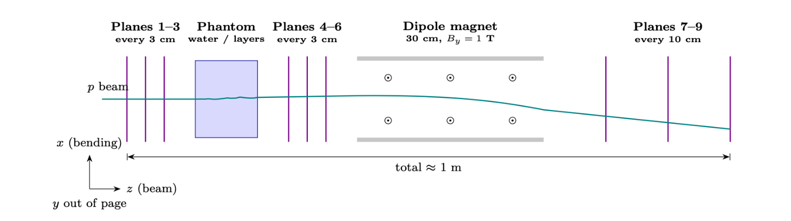

# Track Fitting with a Kalman Filter

Numerical physics project (PHY_51171_EP).
Authors: Alvaro Martinez, Yared Flores, Andrea Cursano




## Description

We simulate charged particles traversing a multi-layer tracking detector
and reconstruct their trajectories using a Kalman filter, accounting for
measurement noise and multiple scattering.

## Installation

```bash
git clone https://github.com/alvaro-martinez-dev/M1_Kalman_Phantom.git
cd M1_Kalman_Phantom
```

### (A.I) You work with conda (Anaconda, Miniconda or Miniforge):
```bash
conda env create -f environment.yml
conda activate env_py312_kalman
```
If the environment `env_py312_kalman` already exists and `environment.yml` has changed:

```bash
conda env update -n env_py312_kalman -f environment.yml
```

### (A.II) You work with mamba (comes with Miniforge, faster installation):
```bash
mamba env create -f environment.yml
mamba activate env_py312_kalman
```
If the environment `env_py312_kalman` already exists and `environment.yml` has changed:

```bash
mamba env update -n env_py312_kalman -f environment.yml
```

### (B) You work with pip (requires Python 3.12):
```bash
python -m venv .venv
.venv\Scripts\activate          # Windows
source .venv/bin/activate       # Linux / macOS
pip install -r requirements.txt
```
If the environment `.venv` already exists and `requirements.txt` has changed:

```bash
pip install -r requirements.txt --upgrade
```


## Usage

All the commands are run from the root of the repository (`python -m ...` needs it to
find `src/`, `scripts/` and `plotting/`).

### (1) Activate the environment

```bash
conda activate env_py312_kalman     # conda
mamba activate env_py312_kalman     # mamba
.venv\Scripts\activate              # pip, Windows
source .venv/bin/activate           # pip, Linux / macOS
```

On Windows, calling the `python.exe` of the conda environment directly without activating it
makes matplotlib fail to load its DLLs, and Python exits silently.

### (2) Generate an initial beam dataset

```bash
python -m scripts.generate_init_beam --beam proton
```

Generates `run.n_events` tracks of the beam block `proton` of `configs/config.yaml`
(with seed `run.seed`) and saves them in `data/init_beam/proton_n<n_events>_seed<seed>_Beam<hash>/`
(see [Dataset names](#dataset-names)):

- `tracks.parquet`: one row per track (see `src/montecarlo/tracks.py`)
- `metadata.yml`: date, git commit and the parameters of the yaml used
- `report.pdf`: validation plots of the dataset, if `run.plot` is `true`

Options: `--config <name or path>`, `--beam <block>` (default: `run.beam`),
`--name <folder>`, `--overwrite`, `--plot`/`--no-plot` (default: `run.plot`).

To redo only the plot report of an existing dataset:

```bash
python -m plotting.plot_init_beam init_beam/proton_n100000_seed42_Beamca5fcd
```

### (3) Generate system layout and magnetic field (optional, visual check)

```bash
python -m scripts.generate_layout
python -m scripts.check_field
```

This step is only a visual check of the geometry and of the magnetic field: nothing else reads
its output. The propagation of step (4) builds the geometry and the field from the yaml by
itself, so this step can be skipped.

#### Layout

Builds the geometry (phantom, phantom interfaces, magnet) and the detector planes from the
`geometry` block of `configs/config.yaml` and saves the layout along z in
`data/geometry/layout_Lay<hash>_<n>Det_<m>Layers_<p>PhDet_<k>MagDet/`, with `hash` a short
deterministic hash of the layout parameters (positions, thicknesses, materials, number of
planes): the same config always gives the same folder, and two configs that differ in anything
that changes the layout never share one. The propagations made on this layout carry the same
`Lay<hash>` in their name. `n` is the total number of detector planes, `m` the number of phantom
layers, `p` the detector planes at the internal interfaces of the phantom (`m - 1` if
`inside_phantom: true`, else 0) and `k` the detector planes strictly inside the magnet
(`n_inside_magnet`). For example `layout_Lay255033_10Det_2Layers_1PhDet_1MagDet`:

- `layout.csv`: one row per z position, with the physical boundary and/or detector plane
  placed there, and the region and material just before and just after it
- `metadata.yml`: date, git commit, the layout parameters with their hash and the `geometry` block used
- `report.pdf`: schematic of the system along z (phantom layers coloured by material, magnet,
  detector planes and boundaries) and the layout table, if `run.plot` is `true`

Options: `--config <name or path>`, `--detectors`/`--no-detectors` (default:
`geometry.detector_planes.enabled`; without them only the physical boundaries are saved),
`--overwrite`, `--plot`/`--no-plot` (default: `run.plot`).

The phantom, the magnet and the detector planes can each be removed with `enabled: false` in
their block of the yaml (their other keys are kept but not read). Without phantom or magnet the
free regions around it merge and get the detector planes of both (see `src/geometry/detectors.py`).

Plotting the report:

```bash
python -m scripts.generate_layout                      # layout + report.pdf if run.plot is true
python -m scripts.generate_layout --plot               # layout + report.pdf, whatever run.plot says
python -m scripts.generate_layout --no-plot            # layout only
python -m plotting.plot_layout geometry/layout_Lay255033_10Det_2Layers_1PhDet_1MagDet   # redo only the report
```

#### Magnetic field

Builds the field of the `geometry.magnet` block exactly as the propagator uses it
(`src.field.build_field`: `model`, `B0` and `interpolation`) and saves it in
`data/field/field_Magn<hash>_<model>[_interp]/`, with `hash` a short deterministic hash of what
changes the field in the `magnet` block (the keys of the unused model and a disabled
interpolation grid are left out) and, if interpolated, of the extent of the system (which sets the
interpolation grid). The propagations made with this field carry the same `Magn<hash>` in their
name:

- `field.pdf`: By(z) along the whole system at x = 0 and x = `x_offset`, with the magnet edges
  and the uniformity window, and By(x) across the gap at the magnet centre, with the plates.
  If `interpolation.enabled`, the source field (no interpolation) is drawn dashed on top
- `metadata.yml`: date, git commit, the `magnet` block used, `magnet_hash` and the parameters it
  is computed from, the plot ranges and the results:
  By at the centre, max deviation in the uniformity window, integral of By dz at x = 0,
  effective length and (if interpolated) max interpolation error

Options: `--config <name or path>`, `--x-offset <mm>` (default: 0.8 `x_half_gap`),
`--window <mm>` (half width of the uniformity window, default 100), `--name <folder>`,
`--overwrite`. It fails if the magnet is disabled (there is no field to plot).

### (4) Propagate the tracks through the system (Monte Carlo truth)

```bash
python -m scripts.generate_propagation
```

Takes the initial tracks of `propagator.input` (a dataset of step (2), e.g.
`init_beam/proton_n100000_seed42_Beamca5fcd`), keeps `propagator.n_max` of them chosen at random (all of
them if `null`; it must not exceed the tracks of the input), propagates each one through the
system of the `geometry`
block and stores its **true** state at every detector plane. The detector resolution is not
applied here: the propagation is the slow step, so it is done once and the hits can be smeared
afterwards with any `sigma_x`.

What happens to each track, from its `z0` to the end of the system:

- **Vacuum**: straight line where there is no field, Runge-Kutta-Nyström where there may be
  (also the fringe field before and after the magnet). |p| is constant.
- **Phantom**: energy loss (Bethe-Bloch) and field coupled, Runge-Kutta on (x, tx, q/p).
  Each layer is cut into slices of at most `propagator.scattering.max_slice` mm, and a random
  multiple-scattering kick (dx, dtx) is applied at the end of each slice (Highland with the
  local momentum). A particle whose range ends in the phantom stops there.
- **Magnet**: field from `geometry.magnet` (tabulated once over the whole system if
  `interpolation.enabled`); outside the gap (|x| > `x_half_gap`) the field is zero.

`propagator.seed` gives two independent random streams: one for the choice of the `n_max`
tracks and one for the kicks. The chosen tracks keep their order and their `event_id` of the input.

The output goes to `data/propagation/<beam>_Beam<h>_Lay<h>_Magn<h>_Prop<h>_seed<seed>[_n<n-max>]/`
(see [Dataset names](#dataset-names)), e.g.
`proton_Beamca5fcd_Lay255033_Magn5a08f2_Propb14662_seed45_n1000`:

- `tracks.parquet`: one row per track: `input_row` (its row in the input dataset), `event_id`,
  `stopped`, final state (`z_final`, `x_final`, `tx_final`, `q_over_p_final`, `T_final`) and
  `n_planes`, the number of planes it reached
- `states.parquet`: one row per (track, plane reached): `track_id`, `input_row`, `event_id`, `plane_index`,
  `plane`, `z`, `x`, `tx`, `q_over_p`, `T`. A track that stops in the phantom has no rows after
  it stops, so the absorption shows as fewer tracks in the later planes
- `metadata.yml`: date, git commit, input dataset, the hashes of the name (`beam_hash`,
  `layout_hash`, `magnet_hash`, `propagator_hash`), seed, `n_max`, the detector planes (name and
  z), `layout_name` (the folder of step (3) with this geometry, the one `generate_layout` writes
  for it) and the `geometry` and `propagator` blocks used
- `tracks_on_layout.pdf`: 5 random tracks drawn on the schematic of the system, as their full
  trajectory plus their true state at each plane, if `run.plot` is `true`. Along each track,
  ⊙ / ⊗ mark the field it crosses: B_y > 0 (out of the page) / B_y < 0 (into the page), with
  size growing with |B_y| (only where |B_y| > 5 % of B0)

The geometry is the `geometry` block of the yaml, as in step (3). The layout folder of step (3)
is not needed: the plot rebuilds the schematic from the metadata of the dataset, so the tracks
are always drawn on the system they were propagated in.

Options: `--config <name or path>`, `--input <dataset>` (default: `propagator.input`),
`--n-max <n>` (default: `propagator.n_max`), `--workers <n>` (default: `propagator.n_workers`),
`--name <folder>`, `--overwrite`, `--plot`/`--no-plot` (default: `run.plot`).

Speed: about 70 ms per track that crosses the whole system with `step: 1.0`, in one process
(100 000 tracks take about 2 hours), so start with a small `n_max`. Only charged particles of a
single species, going forwards (`pz0 > 0`), can be propagated: a neutral beam (e.g. `jpsi`)
leaves no hits.

Each track has its own random stream for the kicks (from `propagator.seed` and its row in the
input), so any track can be propagated again on its own and it is exactly the same track.

#### Multiprocessing

The tracks are propagated in parallel in `propagator.n_workers` processes
(`src/propagator/multiprocess_propagation.py`, with `concurrent.futures.ProcessPoolExecutor` of
the standard library). The tracks are split into contiguous chunks, each process propagates its
chunks and the results are joined back in order. Since each track has its own random stream, the
output is **exactly the same** whatever the number of processes. A `tqdm` progress bar shows the
tracks done.

- `n_workers: 1` runs in a single process (no multiprocessing); `null` (default) uses half the
  logical CPUs of the computer it runs on (about the physical cores), so the same yaml adapts to
  any PC. A number larger than the logical CPUs of the computer is lowered to them, with a warning.
- Processes, not threads: the GIL of Python lets only one thread run Python code at a time, so
  threads would not speed up the propagation. Each process is a separate Python with its own copy
  of the propagator (geometry and field, ~1.5 MB).
- Each process takes a few seconds to start (it imports numpy/scipy/pandas; on Windows the
  processes start from scratch), during which the bar stays at 0 %. With a few hundred tracks or
  fewer, `--workers 1` is faster.
- Do not use more processes than physical cores: with hyperthreading the two logical CPUs of a
  core compete for it. Measured with 1000 tracks on 16 logical CPUs (8 cores):

  | processes | 1 | 4 | 8 | 16 |
  |---|---|---|---|---|
  | time | 71 s | 30 s | 30 s | 50 s |

- On Windows the processes import the main script again: any script that calls
  `propagate_tracks_parallel` must have its code under `if __name__ == "__main__":`.

The plot propagates the chosen tracks again with many points (the dataset only has the
states at the planes). It checks that they are the tracks of the dataset by propagating them once
more exactly as the Monte Carlo did (only the planes as output points, same random stream), which
must give the same x at the planes: the extra points of the drawing are extra cuts of the
fixed-step Runge-Kutta, so the drawn line itself may differ by ~1e-3 mm. A warning means that the
code or the input changed after the propagation. To redo only the plot of an existing dataset, or
with other options:

```bash
python -m plotting.plot_tracks propagation/proton_Beamca5fcd_Lay255033_Magn5a08f2_Propb14662_seed45_n1000
python -m plotting.plot_tracks propagation/proton_Beamca5fcd_Lay255033_Magn5a08f2_Propb14662_seed45_n1000 --n-tracks 7 --seed 3
```

Options: `--n-tracks <1-7>` (default 5), `--seed <n>` (choice of the tracks, default 0),
`--dz <mm>` (spacing of the points of the trajectory, default 2), `--out <pdf>`.

### (5) Generate the hits on the detector planes (Monte Carlo measurement)

```bash
python -m scripts.generate_hits
```

Takes the propagation dataset of `hits.input` (step (4)) and smears the true x of each track at
each plane it reached with the resolution of the detectors:

x_meas = x_true + N(0, `hits.sigma_x`)

The system is 2D (x, z), so each plane measures only x (not the slope nor the momentum). For the
Kalman filter each hit is a scalar measurement with H = [1, 0, 0] on (x, tx, q/p) and variance
`sigma_x`². This step is fast (seconds) and needs neither the geometry nor the field (the z of the
planes are in the propagation dataset), so several resolutions or seeds can be tried on the same
propagation.

The output goes to `data/hits/<propagation name>_hits_sigma<sigma_x>mm_seed<seed>/`:

- `hits.parquet`: one row per (track, plane reached), **only what the detector measures**:
  `track_id`, `input_row`, `event_id`, `plane_index`, `plane`, `z` (of the plane), `x_meas`,
  `sigma_x`. The truth stays in `states.parquet` of the propagation and is joined by
  (`track_id`, `plane_index`) to validate (residuals, pulls)
- `tracks.parquet`: one row per track: `track_id`, `input_row`, `event_id`, `particle`, `n_hits`
- `metadata.yml`: date, git commit, the propagation dataset used (`input`, its creation date and
  git commit) and, under `propagation`, its initial beam dataset, seed, layout and hashes, so the
  hits can be traced back to the beam; plus the `seed`, `sigma_x` and the detector planes
- `report.pdf`, if `run.plot` is `true`: the hits against the MC truth of their propagation
  (`plotting/plot_hits.py`):
  1. residuals x_meas − x_true and pulls (x_meas − x_true)/σ_x of all the hits, against
     N(0, σ_x) and N(0, 1) with their χ², and the residual against x_true (no correlation expected:
     the error does not depend on where the track crosses the plane)
  2. per detector plane: hits (against the tracks), and mean and std of the residuals against
     0 and σ_x, with their errors and χ²
  3. a few tracks: their hits and true states at the planes, and their residuals

Each track has its own random stream for its measurement errors (from `hits.seed` and its row in
the initial beam dataset, as the kicks of the propagation): the hits of a track do not depend on
the other tracks or on how many there are.

Options: `--config <name or path>`, `--input <propagation dataset>` (default: `hits.input`),
`--sigma-x <mm>` (default: `hits.sigma_x`), `--seed <n>` (default: `hits.seed`),
`--name <folder>`, `--overwrite`, `--plot`/`--no-plot` (default: `run.plot`).

To redo only the report of an existing dataset:

```bash
python -m plotting.plot_hits hits/proton_Beamca5fcd_Lay255033_Magn5a08f2_Propb14662_seed45_n1000_hits_sigma0.1mm_seed46
```

Options: `--n-tracks <1-7>` (tracks of page 3, default 5), `--seed <n>` (their choice, default 0),
`--out <pdf>`.

### (6) Fit the tracks with the Kalman filter

```bash
python -m scripts.generate_fit
```

Takes the hits dataset of `kalman.input` (step (5)) and fits each track with an extended Kalman
filter on the state (x, tx, q/p) and, if `kalman.smoother` is `true`, the Rauch-Tung-Striebel
smoother on top of it (`src/kalman/`). The fit never reads the MC truth: it only sees `x_meas` and
`sigma_x` of the hits.

**The model of the fit is the one of the Monte Carlo.** The geometry, the field and the
propagator are rebuilt from the metadata of the propagation dataset the hits come from, and the
prior from the `beam` block of its initial beam dataset, not from the current yaml: the fit always
uses the system that was simulated. The **code** must still be the same: if the field or the
propagator code changed after the propagation, the fit is biased (e.g. a change of the B0
normalisation of Biot-Savart biases q/p by several σ), so regenerate the propagation and the hits.
A warning is printed if the propagation was regenerated after the hits were made from it.

For each track, from the prior at z = 0 and hit by hit in beam order:

- **Prior**: the beam, x0 = `beam.x0`, tx0 = tan(`beam.theta0`), q/p0 = q/`beam.p0`, with
  C0 = diag(σ_x0², ((1 + tx0²) σ_θ0)², (|q| σ_p0 / p0²)²). Only the parameters of the beam, never
  the true initial state of the track.
- **Prediction** (`src/kalman/transport.py`): the mean track is transported to the next plane
  with the propagator of the MC without kicks, cut exactly as the MC cuts it (boundaries, field
  jumps, scattering slices), so it follows the same model everywhere (RKN with the fringe field
  in vacuum, RK on (x, tx, q/p) in the phantom). The Jacobian F is computed by finite differences
  on each piece (forward by default, `kalman.central_differences` for central ones) and chained,
  F = F_n ··· F_1. The process noise Q is the multiple scattering: at the end of each slice, the
  2x2 covariance of (dx, dtx) of `src/propagator/scattering.py`, the same one the MC samples its
  kicks from, evaluated on the mean track and transported by F to the plane. The transport always
  uses fixed RK steps (even if the MC was adaptive): finite differences need the nominal and the
  perturbed propagations to take the same steps.
- **Range constraints** (`kalman.range_constraints`, `src/kalman/constraints.py`): inside the
  phantom the hits barely measure the energy, and a track that stops there never reaches the
  magnet. Its energy is measured by where it stopped: it reached its last hit (s₀ < s_hi) and left
  no hit on the next plane (s₀ > s_lo), with s = 1/p. The boundaries are found with the propagator
  itself (same stopping criterion as the MC) and applied to the prior by truncating its Gaussian
  (constrained Kalman filtering by density truncation). Tracks with energy to spare are not
  affected. The q/p pulls are N(0, 1) except at the last hit of a track that stops, where no
  Gaussian in q/p describes the energy (see the header of `src/kalman/filter.py`).
- **Update** (`src/kalman/filter.py`): each hit is a scalar measurement, H = [1, 0, 0],
  V = σ_x². Residual r = m − H x_pred, S = H C_pred Hᵀ + V, gain K = C_pred Hᵀ / S, covariance
  updated in Joseph form. χ²_k = r² / S.
- **Smoother** (`src/kalman/smoother.py`): RTS backwards over the filter, so that the estimate at
  each plane uses all the hits of the track. It matters most for q/p, which is measured by the
  bending in the magnet, after the phantom: the filter reaches the phantom planes knowing little
  more than the prior, the smoother brings the information of the magnet back to them.

χ² of a track = Σ χ²_k of the filter. Since the prior is the true distribution of the beam, the
predicted residuals are independent N(0, 1) and **ndf = n_hits** (not n_hits − 3).

The output goes to `data/fit/<hits name>_Kal<hash>[_n<n_max>]/`, with `Kal<hash>` the hash of
the options of the fit (`smoother`, `central_differences`, finite-difference steps,
`range_constraints` when true):

- `tracks.parquet`: one row per track: `track_id`, `input_row`, `event_id`, `n_hits`, `status`
  (`ok`, or `stopped` if the predicted track stops in the phantom before one of its hits; such a
  track has no fit rows; with range constraints this should not happen), `chi2`, `ndf`,
  `range_end` (no hit on the plane after the last one: the track stopped), `s_hi`, `s_lo` (range
  bounds on 1/p of the prior, NaN if not applied), `n_reach` (safety-net bounds, normally 0)
- `fit.parquet`: one row per (track, hit): the identifiers and `z`, `x_meas`, `sigma_x` of the
  hit and, for each stage `pred` (prediction), `filt` (filter) and `smooth` (smoother):
  `x_<stage>`, `tx_<stage>`, `q_over_p_<stage>` and their errors `<var>_<stage>_err`; the
  predicted residuals `res_pred`, `res_pred_err`, `chi2_k` and the smoothed ones `res_smooth`,
  `res_smooth_err` (variance V − C_xx: the hit is part of the estimate). The truth is joined
  by (`track_id`, `plane_index`) with `states.parquet` of the propagation
- `metadata.yml`: date, git commit, the hits dataset used and what it was made from (propagation
  with its creation date, commit and hashes, initial beam and its `beam` block), the prior, the
  options of the fit (`kalman_hash`, `smoother`, `central_differences`, finite-difference steps)
  and a summary (tracks fitted and stopped, mean χ²/ndf, time)
- `report.pdf`, if `run.plot` is `true`: the fit against the MC truth (`plotting/plot_fit.py`):
  1. pulls (fit − true)/σ_fit of x, tx and q/p at all the planes against N(0, 1), one page for
     the filter and one for the smoother. The pulls of a track are correlated (q/p barely changes
     along it), so the χ² of these histograms can be > 1 with std ≈ 1
  2. χ² of the tracks against χ²(ndf), and its probability against a flat distribution
  3. per plane: resolution std(fit − true) of x, tx and q/p against the error the fit gives,
     filter and smoother side by side
  4. per plane: mean and std of the pulls, against 0 and 1, with their χ²
  5. a few tracks: fit − true of x and q/p along z with the ±1σ band of the fit, and the hits

Options: `--config <name or path>`, `--input <hits dataset>` (default: `kalman.input`),
`--n-max <n>` (fit only the first n tracks, default: `kalman.n_max`),
`--smoother`/`--no-smoother` (default: `kalman.smoother`), `--workers <n>` (default:
`kalman.n_workers`), `--name <folder>`, `--overwrite`, `--plot`/`--no-plot` (default: `run.plot`).

The tracks are fitted in parallel as the propagation of step (4) (same `n_workers` rules,
`null` = half the logical CPUs): the tracks are independent, so the result does not depend on the
number of processes. Speed: about 0.12 s per track in one process with `step: 1.0` (each piece
is propagated 4 times for the Jacobian, 7 with central differences); 200 tracks take ~23 s with 8
processes, most of it the start of the processes.

To redo only the report of an existing fit:

```bash
python -m plotting.plot_fit fit/<hits name>_Kal<hash>
```

Options: `--n-tracks <n>` (tracks of the last page, default 3), `--seed <n>` (their choice,
default 0), `--out <pdf>`.

### Dataset names

Every folder of `data/` is named after the parameters it was generated from, through short
deterministic hashes (`src/utils/hashing.py`: the first 6 hex characters of the sha256 of the
parameters as sorted json; integers and floats of the yaml are normalised, so `100` and `100.0`
give the same hash). Same parameters give the same name on any computer; anything that changes
the result gives another name, so two datasets of different systems never overwrite each other.

| Hash | Parameters | Folder where it is created |
|---|---|---|
| `Beam<h>` | beam block (particle, x0, theta0, p0 and their sigmas) + `n_events` + `seed` | `init_beam/<beam>_n<n>_seed<s>_Beam<h>` |
| `Lay<h>` | geometry and detector planes (positions, thicknesses, materials, number of planes) | `geometry/layout_Lay<h>_...` |
| `Magn<h>` | what changes the field in the `magnet` block, + the extent of the system if interpolated (only Biot-Savart is: hard edge is always exact) (`Magnoff` without magnet) | `field/field_Magn<h>_...` |
| `Prop<h>` | physics options of the propagator: `step`, `adaptive`, `tolerances` (if adaptive), scattering `max_slice` | (only in the propagation) |
| `Kal<h>` | options of the fit: `smoother`, `central_differences`, finite-difference steps, `range_constraints` (only when true, so older fits keep their hash) | (only in the fit) |

Each dataset cites what it was made from by these hashes, and its children inherit its name:

```
init_beam/   proton_n100000_seed42_Beamca5fcd
geometry/    layout_Lay255033_10Det_2Layers_1PhDet_1MagDet
field/       field_Magn5a08f2_biot_savart_interp
propagation/ proton_Beamca5fcd_Lay255033_Magn5a08f2_Propb14662_seed45_n1000
hits/        proton_Beamca5fcd_Lay255033_Magn5a08f2_Propb14662_seed45_n1000_hits_sigma0.1mm_seed46
fit/         proton_Beamca5fcd_Lay255033_Magn5a08f2_Propb14662_seed45_n1000_hits_sigma0.1mm_seed46_Kalceea7b
```

So `Lay255033` in a propagation is the folder `data/geometry/layout_Lay255033_...` and
`Magn5a08f2` is `data/field/field_Magn5a08f2_...` (if `generate_layout` / `check_field` were run
for that config; they are not needed to propagate). Seeds, sizes and `sigma_x` stay in clear in
the name. What does not change the result (`n_workers`, `plot`) is in no hash. The hashes are also
written in each `metadata.yml`, with the full blocks they come from.

The **code** is not in the name (it would change with every commit): it is the `git_commit` of
each `metadata.yml`. If the field or the propagator code changes, regenerate the datasets.

Datasets made before this naming scheme keep their old names and still load (everything is read
by path).

### Tests

```bash
python -m pytest            # all the tests of tests/
python -m pytest -q tests/test_geometry.py
```


## Repository structure

```
M1_Kalman_Phantom/
├── configs/
│   └── config.yaml          all the parameters: run, beams, decays, geometry, propagator, hits, kalman
├── src/                     main code (importable as src.*)
│   ├── constants.py         particles, decay channels, materials, physical constants
│   ├── geometry/            layout along z
│   │   ├── geometry.py      phantom layers, interfaces, magnet, region/material at each z
│   │   ├── detectors.py     position of the detector planes
│   │   └── layout.py        table of boundaries + detector planes
│   ├── field/               magnetic field models (hard edge, Biot-Savart, interpolated, no field)
│   ├── phantom/             energy loss (Bethe-Bloch), CSDA range, Highland width, dose
│   ├── propagator/          track propagation along z
│   │   ├── propagator.py    region by region: straight line / RKN in vacuum, RK in the phantom
│   │   ├── equations.py     equations of motion of each region
│   │   ├── rk4.py           Runge-Kutta and Runge-Kutta-Nyström integrators
│   │   ├── scattering.py    multiple scattering per slice: theta0, (dx, dtx) covariance, kicks
│   │   └── multiprocess_propagation.py   propagation of many tracks in parallel processes
│   ├── montecarlo/          initial beam, two-body decays, track table, full propagation MC, hits
│   ├── kalman/              track fit
│   │   ├── transport.py     prediction: mean track, Jacobian F (finite differences), process noise Q,
│   │   │                    boundary in 1/p between reaching a plane and stopping before it
│   │   ├── constraints.py   range constraints: truncation of the Gaussian of the state
│   │   ├── filter.py        forward Kalman filter: range constraints on the prior, update with each hit, chi2
│   │   ├── smoother.py      Rauch-Tung-Striebel smoother
│   │   └── fit.py           model from the dataset metadata, beam prior, fit of many tracks (parallel)
│   └── utils/               yaml loading, dataset save/load, hashes of the dataset names, input validation
├── scripts/                 entry points, run as python -m scripts.<name>
│   ├── generate_init_beam.py
│   ├── generate_layout.py
│   ├── generate_propagation.py
│   ├── generate_hits.py
│   ├── generate_fit.py
│   └── check_field.py
├── scans/                   standalone studies of the field model (Biot-Savart, filaments, interpolation dz...)
├── plotting/                pdf reports of the generated data (plot_init_beam, plot_layout, plot_tracks, plot_hits,
│                            plot_fit)
├── data/                    generated outputs, one folder per run
│   ├── init_beam/           <beam>_n<n_events>_seed<seed>_Beam<h>/: tracks.parquet, metadata.yml, report.pdf
│   ├── geometry/            layout_Lay<h>_<n>Det_<m>Layers_<p>PhDet_<k>MagDet/: layout.csv, metadata.yml, report.pdf
│   ├── field/               field_Magn<h>_<model>[_interp]/: field.pdf, metadata.yml
│   ├── propagation/         <beam>_Beam<h>_Lay<h>_Magn<h>_Prop<h>_seed<seed>[_n<n>]/: tracks.parquet,
│                            states.parquet, metadata.yml, tracks_on_layout.pdf
│   ├── hits/                <propagation>_hits_sigma<sigma_x>mm_seed<seed>/: hits.parquet, tracks.parquet, metadata.yml, report.pdf
│   └── fit/                 <hits>_Kal<h>[_n<n>]/: fit.parquet, tracks.parquet, metadata.yml, report.pdf
├── notebooks/               exploration and validation
├── tests/                   pytest tests (python -m pytest)
├── pdf_info/                project proposal, concept figure and guides
├── environment.yml          conda / mamba environment
└── requirements.txt         pip dependencies
```

Every output folder of `data/` carries its `metadata.yml` (date, git commit and parameters used),
so any result can be traced back to the code and config that produced it.

## Results

(Add the main figures here once available: residuals, pulls,
χ² distribution...)

## References

- R. Frühwirth, *Application of Kalman filtering to track and vertex
  fitting*, Nucl. Instrum. Meth. A 262 (1987) 444.
- R. Frühwirth and A. Strandlie, *Pattern Recognition, Tracking and Vertex
  Reconstruction in Particle Detectors*, Springer (2021). Open access.
- A. Strandlie and R. Frühwirth, *Track and vertex reconstruction: From
  classical to adaptive methods*, Rev. Mod. Phys. 82 (2010) 1419.
- R. E. Kalman, *A New Approach to Linear Filtering and Prediction
  Problems*, J. Basic Eng. 82 (1960) 35.
- D. Simon y D. L. Simon, *Constrained Kalman Filtering via Density Function 
  Truncation for Turbofan Engine Health Estimation*, NASA Technical Memorandum NASA/TM-2006-214129 (también ARL-MR-0632, E-15463), NASA Glenn Research Center, 
  Cleveland, OH, abril de 2006. Retrieved from https://ntrs.nasa.gov/citations/20060012173
- E. Lund et al., *Track parameter propagation through the application of
  a new adaptive Runge-Kutta-Nyström method in the ATLAS experiment*,
  JINST 4 (2009) P04001.
- Zeltkevic, M. (1998, April 15). Runge-Kutta methods. Course 10.001 Notes
  Massachusetts Institute of Technology. Retrieved from https://web.mit.edu/10.001/Web/Course_Notes/Differential_Equations_Notes/node5.html
- V. D. Elvira, “Impact of detector simulation in particle physics collider 
  experiments highlights”, EPJ Web Conf. 214, 02019 (2019). doi:10.1051/epjconf/201921402019
- S. Navas et al. (Particle Data Group), *Review of Particle Physics*,
  Phys. Rev. D 110 (2024) 030001. See the reviews *Passage of particles
  through matter* and *Kinematics*.
- G. R. Lynch and O. I. Dahl, *Approximations to multiple Coulomb
  scattering*, Nucl. Instrum. Meth. B 58 (1991) 6.
- NIST PSTAR database, *Stopping-power and range tables for protons*,
  https://physics.nist.gov/PhysRefData/Star/Text/PSTAR.html
- M. Raissi, P. Perdikaris and G. E. Karniadakis, *Physics-informed neural
  networks*, J. Comput. Phys. 378 (2019) 686.