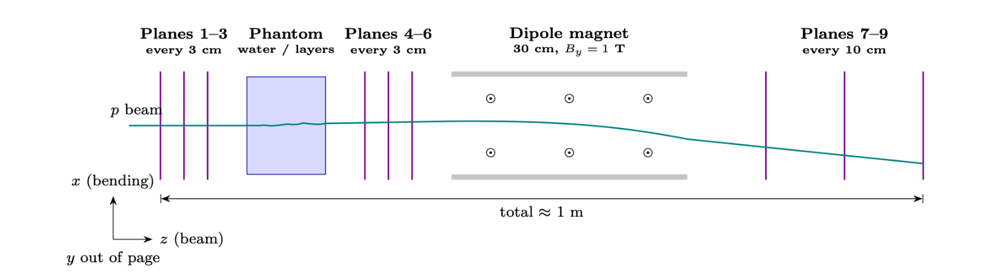

# Track Fitting with a Kalman Filter

Numerical physics project (PHY_51171_EP).
Authors: Alvaro Martinez, Yared Flores, Andrea Cursano




## Description

We simulate charged particles traversing a multi-layer tracking detector
and reconstruct their trajectories using a Kalman filter, accounting for
measurement noise and multiple scattering.

## Installation

```bash
git clone https://github.com/alvaro-martinez-dev/M1_Kalman_Phantom.git
cd M1_Kalman_Phantom
```

### (A.I) You work with conda (Anaconda, Miniconda or Miniforge):
```bash
conda env create -f environment.yml
conda activate env_py312_kalman
```
If the environment `env_py312_kalman` already exists and `environment.yml` has changed:

```bash
conda env update -n env_py312_kalman -f environment.yml
```

### (A.II) You work with mamba (comes with Miniforge, faster installation):
```bash
mamba env create -f environment.yml
mamba activate env_py312_kalman
```
If the environment `env_py312_kalman` already exists and `environment.yml` has changed:

```bash
mamba env update -n env_py312_kalman -f environment.yml
```

### (B) You work with pip (requires Python 3.12):
```bash
python -m venv .venv
.venv\Scripts\activate          # Windows
source .venv/bin/activate       # Linux / macOS
pip install -r requirements.txt
```
If the environment `.venv` already exists and `requirements.txt` has changed:

```bash
pip install -r requirements.txt --upgrade
```


## Usage

All the commands are run from the root of the repository (`python -m ...` needs it to
find `src/`, `scripts/` and `plotting/`).

### (1) Activate the environment

```bash
conda activate env_py312_kalman     # conda
mamba activate env_py312_kalman     # mamba
.venv\Scripts\activate              # pip, Windows
source .venv/bin/activate           # pip, Linux / macOS
```

On Windows, calling the `python.exe` of the conda environment directly without activating it
makes matplotlib fail to load its DLLs, and Python exits silently.

### (2) Generate an initial beam dataset

```bash
python -m scripts.generate_init_beam --beam proton
```

Generates `run.n_events` tracks of the beam block `proton` of `configs/config.yaml`
(with seed `run.seed`) and saves them in `data/init_beam/proton_n<n_events>_seed<seed>/`:

- `tracks.parquet`: one row per track (see `src/montecarlo/tracks.py`)
- `metadata.yml`: date, git commit and the parameters of the yaml used
- `report.pdf`: validation plots of the dataset, if `run.plot` is `true`

Options: `--config <name or path>`, `--beam <block>` (default: `run.beam`),
`--name <folder>`, `--overwrite`, `--plot`/`--no-plot` (default: `run.plot`).

To redo only the plot report of an existing dataset:

```bash
python -m plotting.plot_init_beam init_beam/proton_n100000_seed42
```

To load it in a notebook:

```python
from src.utils.dataset_io import load_dataset
df, cfg = load_dataset("init_beam/proton_n100000_seed42")
```

### (3) Generate system and detector layout

```bash
python -m scripts.generate_layout
```

Builds the geometry (phantom, phantom interfaces, magnet) and the detector planes from the
`geometry` block of `configs/config.yaml` and saves the layout along z in
`data/geometry/layout_<n>Det_<m>Lay/`, with `n` the number of detector planes and `m` the number
of phantom layers:

- `layout.csv`: one row per z position, with the physical boundary and/or detector plane
  placed there, and the region and material just before and just after it
- `metadata.yml`: date, git commit and the `geometry` block used
- `report.pdf`: schematic of the system along z (phantom layers coloured by material, magnet,
  detector planes and boundaries) and the layout table, if `run.plot` is `true`

Options: `--config <name or path>`, `--detectors`/`--no-detectors` (default: with detectors;
without them only the physical boundaries are saved), `--overwrite`,
`--plot`/`--no-plot` (default: `run.plot`).

Plotting the report:

```bash
python -m scripts.generate_layout                      # layout + report.pdf if run.plot is true
python -m scripts.generate_layout --plot               # layout + report.pdf, whatever run.plot says
python -m scripts.generate_layout --no-plot            # layout only
python -m plotting.plot_layout geometry/layout_8Det_1Lay   # redo only the report of an existing layout
```

To build the same table in a notebook:

```python
from src.utils.config_loader import load_config, make_geometry, make_detector_planes
from src.geometry.layout import layout_table

cfg = load_config("config")["geometry"]
geometry = make_geometry(cfg)
detectors = make_detector_planes(geometry, cfg["detector_planes"])
table = layout_table(geometry, detectors)   # layout_table(geometry) for no detectors
```

### Tests

```bash
python -m pytest            # all the tests of tests/
python -m pytest -q tests/test_geometry.py
```


## Repository structure

```
M1_Kalman_Phantom/
├── configs/
│   └── config.yaml          all the physical parameters: run, beams, decays, geometry, kalman
├── src/                     main code (importable as src.*)
│   ├── constants.py         particles, decay channels, materials, physical constants
│   ├── geometry/            layout along z
│   │   ├── geometry.py      phantom layers, interfaces, magnet, region/material at each z
│   │   ├── detectors.py     position of the detector planes
│   │   └── layout.py        table of boundaries + detector planes
│   ├── field/               magnetic field models (hard edge, Biot-Savart, interpolated)
│   ├── phantom/             energy loss (Bethe-Bloch), multiple scattering (Highland), dose
│   ├── montecarlo/          initial beam, two-body decays, standard track table
│   ├── kalman/              Kalman filter (in progress)
│   └── utils/               yaml loading, dataset save/load, input validation
├── scripts/                 entry points, run as python -m scripts.<name>
│   ├── generate_init_beam.py
│   ├── generate_layout.py
│   └── check_biot_savart.py
├── plotting/                pdf reports of the generated data (plot_init_beam, plot_layout)
├── data/                    generated outputs, one folder per run
│   ├── init_beam/           <beam>_n<n_events>_seed<seed>/: tracks.parquet, metadata.yml, report.pdf
│   └── geometry/            layout_<n>Det_<m>Lay/: layout.csv, metadata.yml, report.pdf
├── notebooks/               exploration and validation
├── tests/                   pytest tests (python -m pytest)
├── pdf_info/                project proposal, concept figure and guides
├── environment.yml          conda / mamba environment
└── requirements.txt         pip dependencies
```

Every output folder of `data/` carries its `metadata.yml` (date, git commit and parameters used),
so any result can be traced back to the code and config that produced it.

## Results

(Add the main figures here once available: residuals, pulls,
χ² distribution...)

## References

- R. Frühwirth, *Application of Kalman filtering to track and vertex
  fitting*, Nucl. Instrum. Meth. A 262 (1987) 444.
- R. Frühwirth and A. Strandlie, *Pattern Recognition, Tracking and Vertex
  Reconstruction in Particle Detectors*, Springer (2021). Open access.
- A. Strandlie and R. Frühwirth, *Track and vertex reconstruction: From
  classical to adaptive methods*, Rev. Mod. Phys. 82 (2010) 1419.
- R. E. Kalman, *A New Approach to Linear Filtering and Prediction
  Problems*, J. Basic Eng. 82 (1960) 35.
- E. Lund et al., *Track parameter propagation through the application of
  a new adaptive Runge-Kutta-Nyström method in the ATLAS experiment*,
  JINST 4 (2009) P04001.
- S. Navas et al. (Particle Data Group), *Review of Particle Physics*,
  Phys. Rev. D 110 (2024) 030001. See the reviews *Passage of particles
  through matter* and *Kinematics*.
- G. R. Lynch and O. I. Dahl, *Approximations to multiple Coulomb
  scattering*, Nucl. Instrum. Meth. B 58 (1991) 6.
- NIST PSTAR database, *Stopping-power and range tables for protons*,
  https://physics.nist.gov/PhysRefData/Star/Text/PSTAR.html
- M. Raissi, P. Perdikaris and G. E. Karniadakis, *Physics-informed neural
  networks*, J. Comput. Phys. 378 (2019) 686.